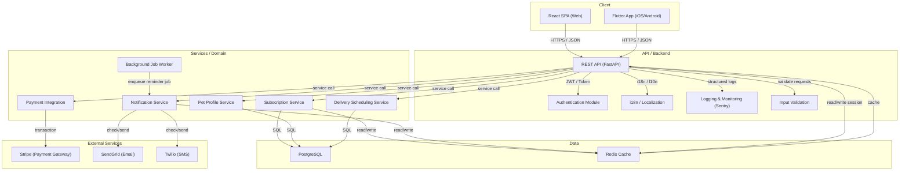
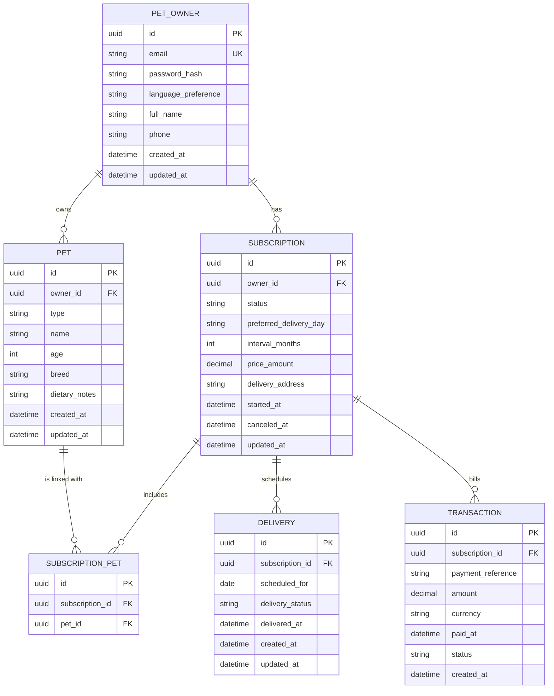
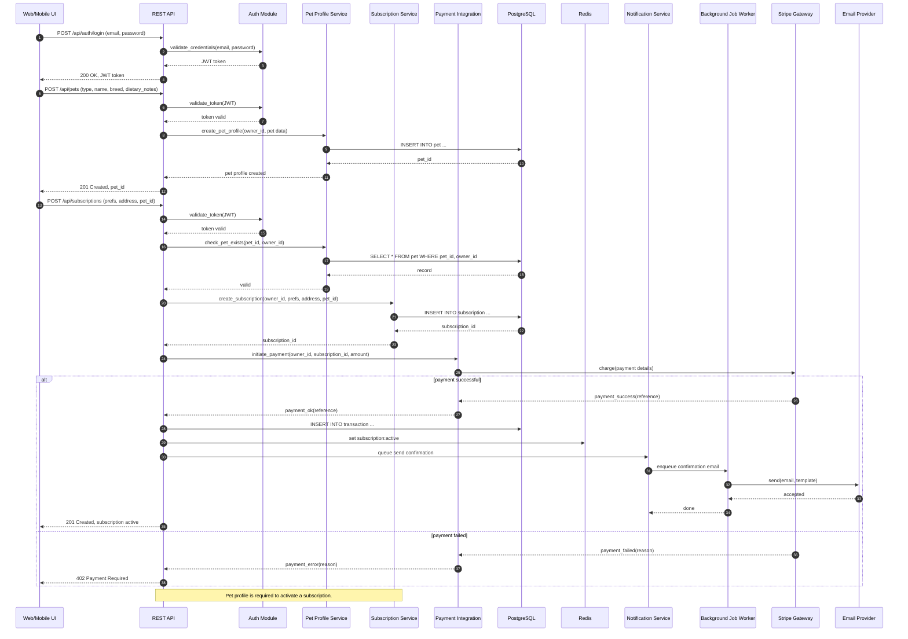

# Pet Food Subscription Service

> Delivering pet food monthly for happy pets!

A low-fidelity prototype of **Pet Food Subscription Service**, generated by an agentic AI project manager from a stakeholder conversation in Slack.

## Screens

- [Home](index.html) — View an overview of the pet food subscription service.
- [Features](features.html) — Learn about the key features of the subscription service.
- [Subscription Process](subscription.html) — Understand how to subscribe and order pet food.
- [Risks and Mitigation](risks.html) — Review potential risks and their mitigation strategies.

## What this prototype fakes

- This prototype fakes the actual functionality of the subscription service.
- Real payment processing and user authentication are not included.

## System design

### Pet Food Subscription Service Architecture

This diagram represents the layered structure of the system. The architecture emphasizes separation of concerns with React SPA and Flutter clients, a FastAPI backend serving as the central coordination point, domain modules aligning with feature sets, and clearly defined integrations for payments and notifications. Caching, authentication, input validation, background jobs, and monitoring are included to ensure responsiveness, security, and observability.

### Pet Food Subscription Service ER Diagram

This ER diagram details the persistent data structures the system requires. It models pet owners, their pets, subscriptions (which connect to both), scheduled deliveries, and transaction/payment records. Many-to-many and one-to-many relationships are explicit, capturing complex subscription preferences and delivery scheduling, while enforcing uniqueness and referential integrity. This approach supports the business logic for recurring orders, reminders, and pet-specific dietary profiles.

### Create Subscription and Place First Order Sequence

This sequence illustrates the end-to-end flow of a pet owner subscribing and placing their first monthly pet food delivery order, which is the core of the service. It includes authentication, pet/profile validation, payment processing via external gateway, persistence of entities, and notification sending via a background worker. An 'alt' block covers payment failure. A business rule note specifies that pet profile is required for subscription activation.

## Running it

Every file is static. Open `index.html`, or serve the directory with any static file server.
